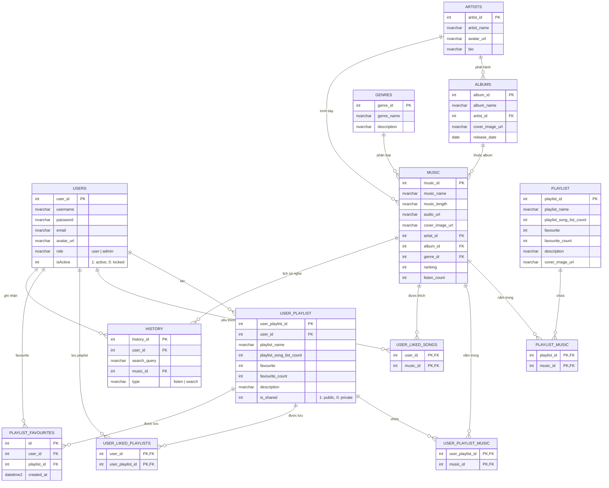

# Sơ Đồ Thực Thể Quan Hệ (ERD) & Cấu Trúc Cơ Sở Dữ Liệu

Dự án **Vinyl Room** sử dụng hệ quản trị cơ sở dữ liệu **Microsoft SQL Server (MSSQL)** quan hệ chuẩn hóa cao, hỗ trợ phân quyền người dùng, danh mục âm nhạc, playlist đa cấp độ và lịch sử nghe nhạc.

---

## 1. Sơ Đồ ERD (Entity Relationship Diagram)

---

## 2. Danh Sách Các Bảng & Mô Tả

| Tên Bảng | Vai Trò & Mô Tả |
|---|---|
| **`users`** | Quản lý tài khoản, mật khẩu, email, avatar, trạng thái kích hoạt (`isActive`), và vai trò phân quyền (`role`: `user` hoặc `admin`). |
| **`artists`** | Danh mục nghệ sĩ / ca sĩ thể hiện. |
| **`albums`** | Danh mục album âm nhạc do nghệ sĩ phát hành. |
| **`genres`** | Danh mục thể loại âm nhạc (Pop, Ballad, Rock, Rap, Jazz, ...). |
| **`music`** | Kho bài hát chính: tên bài, thời lượng, file audio, ảnh bìa, lượt nghe (`listen_count`), thứ hạng. |
| **`playlist`** | Danh sách playlist công cộng / hệ thống tạo sẵn do Admin tuyển chọn. |
| **`playlist_music`** | Bảng trung gian liên kết bài hát vào playlist của hệ thống. |
| **`user_playlist`** | Playlist do người dùng tự tạo, có cờ `is_shared` để bật/tắt chia sẻ cộng đồng (Public/Private). |
| **`user_playlist_music`** | Bảng trung gian liên kết bài hát vào playlist của người dùng. |
| **`user_liked_songs`** | Danh sách các bài hát mà người dùng bấm yêu thích (Liked Songs). |
| **`user_liked_playlists`** | Danh sách playlist của người khác mà người dùng lưu về thư viện cá nhân. |
| **`playlist_favourites`** | Bảng ghi nhận lượt yêu thích playlist phục vụ API backend. |
| **`history`** | Ghi nhận nhật ký nghe nhạc và các từ khóa tìm kiếm gần đây của người dùng. |
